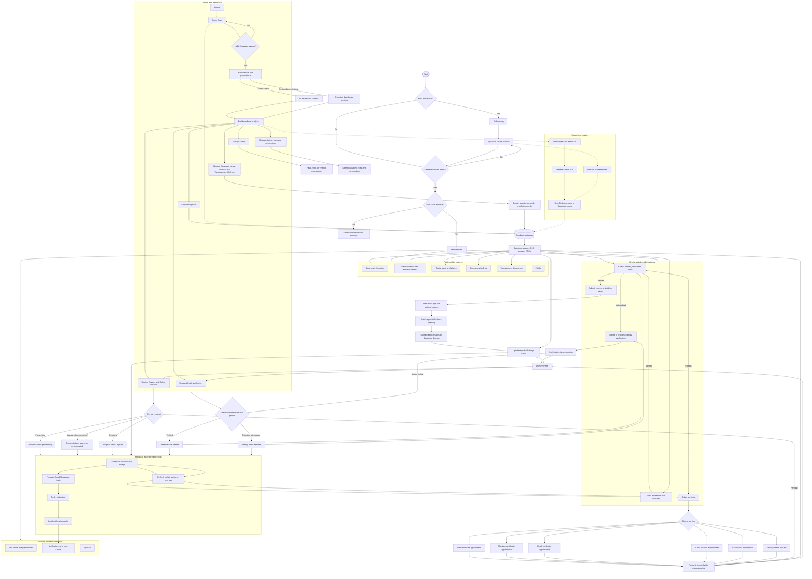
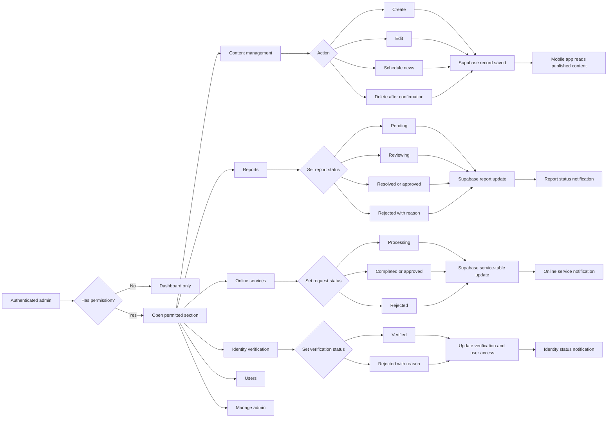
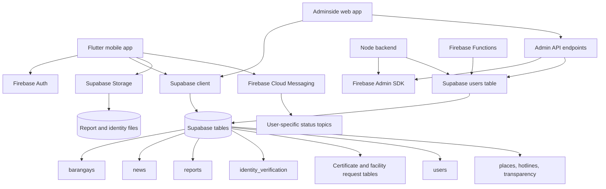
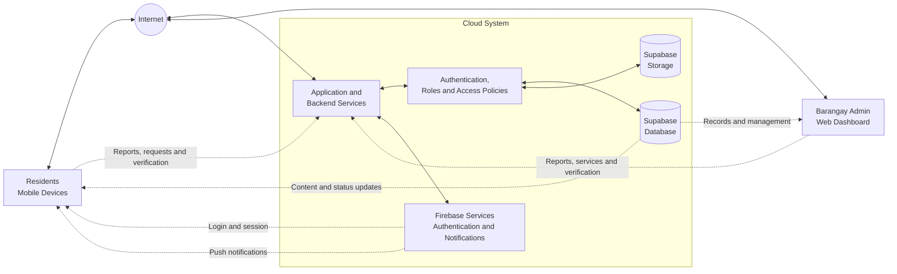

# iTIWI Complete System Flowchart

This flowchart is based on the current Flutter mobile app, `adminside`, backend services, Firebase, and Supabase integration.

## End-to-End System Flow

## Admin Decision Flows

## Main Data Stores and Integrations

## Status Summary

| Process | Initial state | Admin outcome | Mobile result |
| --- | --- | --- | --- |
| Identity verification | `pending` | `verified` or `rejected` | Protected features unlock, or resubmission is requested |
| Incident report | `pending` | `reviewing`, `resolved`, or `rejected` | User sees updated report status and notification |
| Online service request | `pending` | `processing`, `completed/approved`, or `rejected` | User sees request status and notification |
| News/content | Draft or scheduled | Published, updated, or deleted | Published records appear in the mobile app |

## Figure 9. Architectural Design

The architectural design shows how residents and barangay administrators interact
with the iTIWI system through separate user interfaces. Residents use the iTIWI
mobile application to access barangay information, view announcements, submit
reports, request online services, complete identity verification, and monitor the
status of their submissions. Barangay administrators use the web-based admin
dashboard to manage system content, review reports, process online service
requests, verify resident identities, and manage users and administrator roles.

Both user interfaces communicate with the cloud system through the internet. The
application and backend services receive requests from the mobile application and
the administrator dashboard, process the required operations, and connect the
users to the appropriate data and supporting services. Firebase Authentication
handles resident account registration, login, and authentication sessions, while
Firebase Cloud Messaging delivers announcements and status notifications to
resident devices.

The security layer represents the authentication, role permissions, database
policies, and storage access rules that protect the system’s resources. After a
request passes the required access controls, the system communicates with the
Supabase database and Supabase Storage. The database stores user profiles,
barangay information, news, reports, online service requests, identity
verification records, and other system data. Supabase Storage stores uploaded
files such as report images and identity verification documents.

Information follows a two-way communication process. Residents send reports,
service requests, and verification information to the system, while administrators
review and update these records through the dashboard. The results are stored in
Supabase and returned to the resident through the mobile application. When an
important status change occurs, such as a report resolution, service approval, or
identity verification decision, Firebase Cloud Messaging sends a notification to
the resident’s device.

This architecture provides a centralized structure for managing barangay services
and information. It connects residents, administrators, application interfaces,
backend services, authentication, cloud storage, and database components into a
single system. Through this arrangement, the iTIWI system supports secure data
handling, efficient communication, organized record management, and timely
feedback to residents.